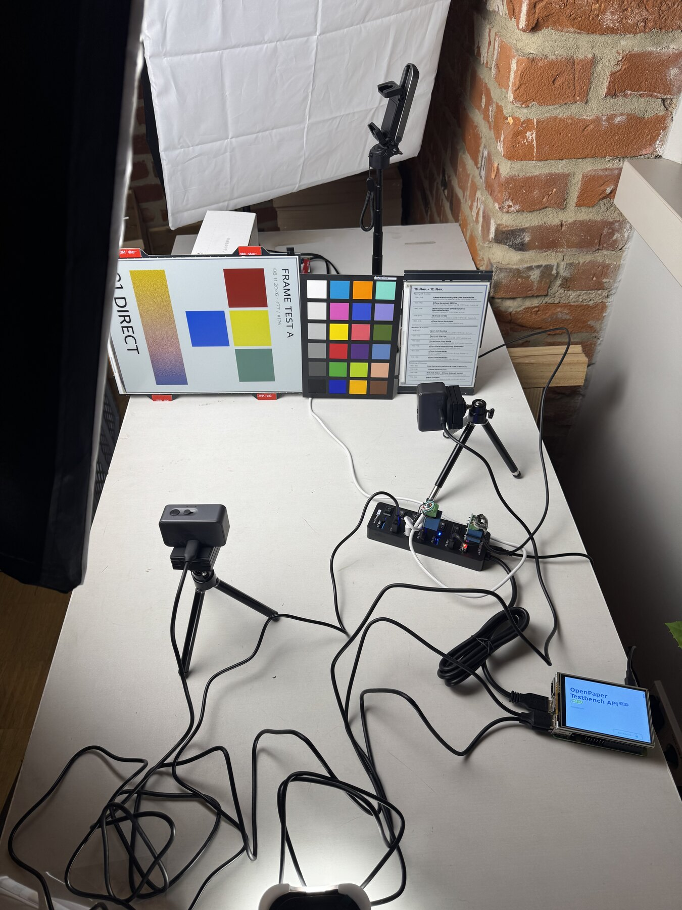
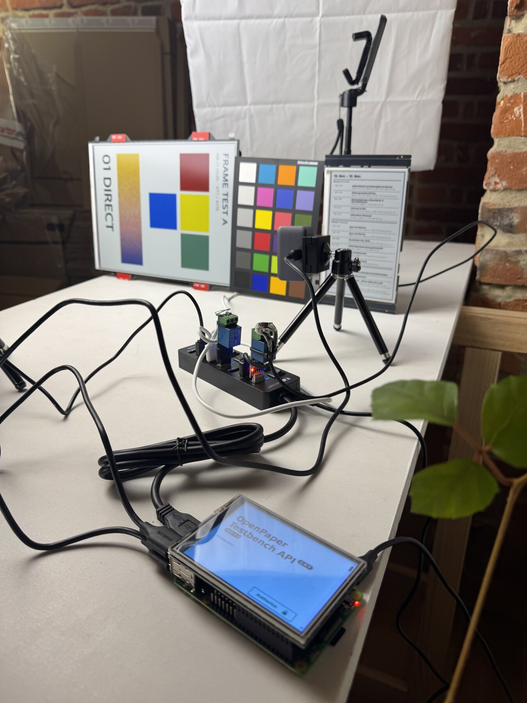
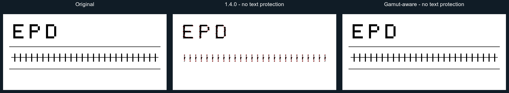

# EPD Optimize

[Interactive tool for optimizing and dithering](https://paperlesspaper.github.io/epdoptimize/)

A JavaScript library for reducing, tone-mapping, and dithering images for color e-paper displays.

E-paper displays have a much smaller reproducible color range than LCD/OLED screens. This library converts images into calibrated palette colors that better match the measured appearance of a target display, then maps those calibrated colors back to the native device colors needed for export.

We use it for our eInk picture frames at [paperlesspaper](https://paperlesspaper.de/en).

The library works in browser JavaScript with the Canvas API and in Node.js when used with [node-canvas](https://www.npmjs.com/package/canvas).

[Blog post](https://paperlesspaper.de/en/blog/dither-eink-tool-open-source)

You can order our Spectra 6 eInk picture frame [here](https://paperlesspaper.de/buy-7-inch-epaper-picture-frame).

[](https://github.com/paperlesspaper/epdoptimize/actions/workflows/npm-publish.yml)

## Panel measurements and test setup

To check how solid colors and dithered mixtures appear on real panels, we photograph them beside a Spyder Checkr 24 reference card with fixed camera settings. The bench below has a 13.3-inch panel on the left and a 7.3-inch panel on the right; these setup photos show earlier test images.

| Panels and reference card | Camera and testbench |
| --- | --- |
|  |  |

The [panel measurement documentation](https://docs.paperlesspaper.de/panels/overview) includes measured swatches for six solid colors and 45 mixtures per panel, original captures, native test patterns, and JSON/CSV downloads. See the results for the [DKE 7-inch panel](https://docs.paperlesspaper.de/panels/dke-7-inch) and [DKE 13.3-inch panel](https://docs.paperlesspaper.de/panels/dke-13-3-inch).

These are camera-based estimates under the test lighting. The measurement pages explain their limits; the new measurements have not been applied to the library's built-in palettes.

## Supported Displays

- [Any Spectra 6 panel](https://www.eink.com/brand?bookmark=Spectra)
- [AcEP / Gallery](https://www.eink.com/brand/detail/Gallery)
- Custom palettes


## What it does

### Calibrated display palettes

Dither against measured display colors, then export native device colors.

**Why?** eInk panels use fully saturated colors internally (for example red: #ff0000), but in reality they can't cover the full sRGB colorspace.

### Multiple dithering modes

Error diffusion, ordered dithering, random dithering, blue-noise/whole-image variants, and quantization-only conversion.

**Why?** Like offset print, most eInk panels can reproduce only a limited set of discrete colors. [Dithering](https://en.wikipedia.org/wiki/Dither) is therefore required to approximate all intermediate colors.

### Advanced tone mapping

Exposure, saturation, contrast, and S-curve controls inspired by [epaper-image-convert](https://github.com/aitjcize/epaper-image-convert).

**Why?** Source images are usually prepared for emissive screens, not reflective eInk. Tone controls make it possible to compensate for muted colors, low contrast, and the different perceived brightness of paper-like displays before dithering.

### Dynamic range compression

LAB lightness remapping into the target display range.

**Why?** eInk palettes have a narrower usable brightness range than the source image. Compressing lightness in LAB space helps preserve shadow and highlight detail instead of clipping it to the nearest available ink color.

### Color matching modes

RGB, LAB, or chroma-aware palette matching.

**Why?** The “nearest” color depends on how distance is measured. RGB matching is simple and predictable, LAB better reflects human perception.

### Experimental: Edge handling

Preserve hard line-art/text edges or smooth antialiased edge bands after dithering.

**Why?** ithering can make text, icons, and line art look noisy or fuzzy. Edge handling keeps sharp content readable while still allowing smoother treatment for photographic or antialiased areas.

### Gamut-aware native error diffusion

Native `ditheringType: "errorDiffusion"` projects each adjusted source color onto
its palette's reachable RGB mixture gamut before adding the accumulated
floating-point error. This avoids repeatedly diffusing an impossible difference
such as screen white (`#FFFFFF`) versus calibrated display white (`#BEC8C8`).
Reachable intermediate colors remain intermediate colors: cyan can still use a
blue/green/white mixture rather than collapsing to white.

This runs without text detection, masks, or `protectTextAndGraphics`. It applies
to photos as well as graphics, so it can change photo hues, highlights, and raster
patterns. It does not guarantee exact preservation of arbitrary colored or
antialiased text, especially beside photographic content. The optional spatial
text/graphics protection below remains available for that separate purpose.

Projection supports palettes with up to eight distinct colors, including
one-color, collinear and planar palettes. Longer collinear palettes (such as
16-level grayscale) are supported too; larger non-collinear palettes keep the
previous signed-error path. Projection uses RGB code values, consistent with the
native diffusion residuals; it is not a physical linear-light pigment model.
Other dithering modes and DitherIt-backed aliases are unchanged.

JavaScript and RGB WASM use the same Float64 projection. The WASM host streams one
projected row at a time, retaining the bounded row error buffer and an exact-key
projection cache capped at 65,536 entries. Lab/chroma matching uses JavaScript as
before. Incoming diffusion errors are not projected back into gamut or rounded
into bytes.



The synthetic sharp-edge comparison can be regenerated with
`node scripts/render-gamut-comparison.mjs /path/to/epdoptimize-1.4.0/dist/index.mjs`
after `npm run build` (requires ImageMagick). Both outputs use the same source,
calibrated palette, Sierra-3, serpentine scanning, Lab matching and disabled text
protection. See [validation and limitations](docs/gamut-error-diffusion.md).

### Experimental: Automatic text and graphics protection

For flattened layouts containing both images and text, enable
`protectTextAndGraphics`. It first finds connected, nearly uniform candidates
of any color, then uses their spatial context to form coherent layout regions.
Isolated candidate patches inside photos are removed; small lettering gaps and
antialiased strokes within supported text/graphics areas are completed. Nearly
rectangular continuous-tone components are kept as whole image/gradient regions,
including their bright edge pixels. There is no fixed top/bottom or left/right
template, and an image inset inside a text area is not simply filled in.
For cutout illustrations sharing a flat page background with text, repeated
aligned foreground shapes can recover a background rejected by the initial
edge test. Continuous-tone foreground components retain an excluded bounding
box, including pale details inside the object. This recovery also tolerates
antialiasing and moderate JPEG edge artifacts; it does not identify the object
semantically or trace its exact silhouette.

Protected regions are directly quantized to the selected palette. The rest
continues through the selected dithering algorithm. No manually drawn mask or
external OCR service is required. The demo has a **Protect text & graphics (Experimental)** checkbox;
the generated JSON/JavaScript config includes the option when enabled.

```ts
await ditherImage(inputCanvas, outputCanvas, {
  palette: aitjcizeSpectra6Palette,
  ditheringType: "errorDiffusion",
  serpentine: true,
  protectTextAndGraphics: true,
});
```

This is a conservative spatial heuristic, **not semantic text recognition**.
Large flat areas can still be selected within illustrations or photos. Text
directly over photos, low-contrast text and textured/scanned posters remain
ambiguous; grouping may leave an entire uncertain scan in dithering rather than
protect scattered fragments. Quantization can merge
foreground/background colors on a limited palette; protection does not guarantee
text contrast or the original color. Review the result for the target display.

Detection runs at output resolution **after image adjustments**. Resize before
dithering. In a split pipeline, run `detectTextAndGraphics` on the adjusted
canvas's `ImageData` to inspect the same mask used by `ditherCanvas`:

```ts
const detection = detectTextAndGraphics(adjustedImageData);
// detection.mask: Uint8Array, one byte per pixel (1 = protected, 0 = dither).
// Also returns width, height, protectedPixels and regionCount.
```

The optional object form accepts `enabled` (default `true`), `colorTolerance`
(default `6`, per-channel seed deviation), `edgeContrast` (default `48`, minimum
channel contrast at most boundary pixels), and `minRegionPixels` (default `12`).
`regionGrouping` defaults to `true`; set it to `false` to inspect/reproduce the
older pixel candidates without spatial grouping. With grouping enabled,
`regionCount` counts the final connected protected areas; otherwise it counts
the initial accepted flat regions.
For example, `{ colorTolerance: 10, edgeContrast: 36 }` relaxes detection for
imperfect sources, with a greater risk of selecting photographic detail. Results
are scale dependent; the default is deliberately opt-in, including in Auto mode.

Protected pixels neither receive nor emit diffusion error. Color-mixture,
thickness and neighborhood checks limit how small gaps are completed; large
textured areas and gradients remain excluded. Protection takes precedence over
the older edge postprocessing options.
When regions are detected, native error diffusion runs in JavaScript even with
`processingEngine: "auto"` or `"wasm"`. `ditherItErrorDiffusion` uses the internal
mask-aware kernel implementation instead of RgbQuant; Riemersma clears its error
history at protected pixels. The ordinary paths are unchanged when disabled or
when no regions are detected. `replaceColors` remains the final device encoding
step.

Run `npm run test:text-graphics` for regression tests, or
`npm run test:text-graphics:demos` for the local demo collection (requires
ImageMagick and `examples/sampleImages`). The latter writes original/before/after
PNGs, masks, a browsable report and `results.json` to
`output/selective-quantization/`. Inputs are reduced to a maximum 800-pixel edge,
without upscaling or padding; no adjustments are applied and outputs are never
resized. Override with `DEMO_LONG_EDGE=1200`. Mask coverage is a diagnostic, not
an accuracy score.

Run `npm run test:text-graphics:layouts` for six flattened compositions with a
photo above/below/beside text, a framed image and a small photo inset in a text
area. It writes a before/after report to `output/region-protection/layouts/` and
checks photo exclusion, complete text/background protection and exact palette
quantization. Layout rectangles are used only as evaluation ground truth, never
as input to detection. Use `DEMO_OUTPUT_DIR=output/region-protection/demos` with
the demo command to keep a separate full-collection report.

### Automatic processing suggestions

Heuristically classify the image, score presets, and suggest dither options for the selected palette.

**Why?** Photos, screenshots, comics, and text-heavy images benefit from different conversion settings. Automatic suggestions provide a better starting point without requiring manual tuning for every image.


[Visit the dithering tool](https://paperlesspaper.github.io/epdoptimize/)

## Installation

```bash
npm install epdoptimize
```

## Quick Start

```html
<canvas id="inputCanvas"></canvas>
<canvas id="ditheredCanvas"></canvas>
<canvas id="deviceCanvas"></canvas>
```

```js
import {
  ditherImage,
  replaceColors,
  aitjcizeSpectra6Palette,
} from "epdoptimize";

const inputCanvas = document.getElementById("inputCanvas");
const ditheredCanvas = document.getElementById("ditheredCanvas");
const deviceCanvas = document.getElementById("deviceCanvas");

await ditherImage(inputCanvas, ditheredCanvas, {
  palette: aitjcizeSpectra6Palette,
  processingPreset: "balanced",
  ditheringType: "errorDiffusion",
  errorDiffusionMatrix: "floydSteinberg",
  serpentine: true,
});

replaceColors(ditheredCanvas, deviceCanvas, aitjcizeSpectra6Palette);
```

`ditherImage` uses each entry's calibrated `color` value. `replaceColors` then maps every matching `color` to its corresponding `deviceColor`.

## Automatic Processing

If you do not want to choose a preset manually, use the auto recommender. It analyzes the source image and target palette, then returns concrete `ditherOptions` plus the reasons behind the choice.

```js
import {
  ditherImage,
  replaceColors,
  aitjcizeSpectra6Palette,
  suggestCanvasProcessingOptions,
} from "epdoptimize";

const suggestion = suggestCanvasProcessingOptions(
  inputCanvas,
  aitjcizeSpectra6Palette,
);

await ditherImage(inputCanvas, ditheredCanvas, {
  ...suggestion.ditherOptions,
  palette: aitjcizeSpectra6Palette,
});

replaceColors(ditheredCanvas, deviceCanvas, aitjcizeSpectra6Palette);

console.log(suggestion.imageKind);
console.log(suggestion.reasons);
```

The optional `intent` can steer the recommendation:

```js
const suggestion = suggestCanvasProcessingOptions(
  inputCanvas,
  aitjcizeSpectra6Palette,
  {
    intent: "readable",
  },
);
```

Available intents are `natural`, `vivid`, `readable`, `faithful`, and `lowNoise`.

For editors, you can request the automatic values for each pipeline stage
separately. These helpers do not mutate your canvas or UI state; they only
return the calculated settings so you can apply them to your own image or
canvas controls.

```js
import {
  aitjcizeSpectra6Palette,
  ditherImage,
  replaceColors,
  suggestCanvasDitherOptions,
  suggestCanvasImageAdjustmentOptions,
} from "epdoptimize";

// Selected image/item stage: copy these values into the selected image settings.
const imageAuto = suggestCanvasImageAdjustmentOptions(
  selectedImageCanvas,
  aitjcizeSpectra6Palette,
);

selectedImage.settings = {
  ...selectedImage.settings,
  ...imageAuto.adjustmentOptions,
};

// Canvas/export stage: copy these values into the global canvas dither settings.
const canvasAuto = suggestCanvasDitherOptions(
  composedCanvas,
  aitjcizeSpectra6Palette,
);

canvas.settings = {
  ...canvas.settings,
  ...canvasAuto.ditherOptions,
};

await ditherImage(composedCanvas, ditheredCanvas, {
  ...canvas.settings,
  palette: aitjcizeSpectra6Palette,
});

replaceColors(ditheredCanvas, deviceCanvas, aitjcizeSpectra6Palette);
```

The split result shapes are:

```ts
type AutoImageAdjustmentOptions = {
  clarity?: ClarityOptions;
  toneMapping?: ToneMappingOptions;
  dynamicRangeCompression?: DynamicRangeCompressionOptions | boolean;
  levelCompression?: LevelCompressionOptions;
  paperNormalization?: PaperNormalizationOptions;
};

type AutoCanvasDitherOptions = {
  colorMatching?: ColorMatchingMode;
  ditheringType?: DitheringType;
  errorDiffusionMatrix?: string;
  serpentine?: boolean;
};
```

`suggestCanvasDitherOptions` intentionally does not return
`processingPreset` inside `ditherOptions`, because presets can also imply image
tone and range defaults. The recommended preset is available as metadata on
`canvasAuto.presetName`.

For a Fabric.js editor integration with custom per-image filters and simplified
highlights/shadows controls, see [FABRIC_FILTER_README.md](FABRIC_FILTER_README.md).

## Palette Format

Palettes live in [src/dither/data/default-palettes.json](src/dither/data/default-palettes.json). Each palette is an array of entries:

```json
{
  "spectra6": [
    { "name": "black", "color": "#1F2226", "deviceColor": "#000000" },
    { "name": "white", "color": "#B9C7C9", "deviceColor": "#FFFFFF" },
    { "name": "blue", "color": "#233F8E", "deviceColor": "#0000FF" },
    { "name": "green", "color": "#35563A", "deviceColor": "#00FF00" },
    { "name": "red", "color": "#62201E", "deviceColor": "#FF0000" },
    { "name": "yellow", "color": "#C1BB1E", "deviceColor": "#FFFF00" }
  ]
}
```

The fields mean:

- `name`: Stable role used to align palette colors with device colors.
- `color`: Calibrated display appearance used for dithering and color matching.
- `deviceColor`: Native output color sent to the display.

You can pass one combined palette to both `ditherImage` and `replaceColors`.

## Built-In Palettes

Built-in palettes are exported as combined palette entries, so the same import can be passed to both `ditherImage` and `replaceColors`.

```js
import {
  ditherImage,
  replaceColors,
  aitjcizeSpectra6Palette,
} from "epdoptimize";

await ditherImage(inputCanvas, ditheredCanvas, {
  palette: aitjcizeSpectra6Palette,
  processingPreset: "dynamic",
});

replaceColors(ditheredCanvas, deviceCanvas, aitjcizeSpectra6Palette);
```

This is the same pattern used by the demo's generated JS example.

## Custom Palettes

For a display-ready conversion, define entries with both calibrated colors and native device colors:

```js
const myPalette = [
  { name: "black", color: "#1c1f22", deviceColor: "#000000" },
  { name: "white", color: "#d8d8d2", deviceColor: "#FFFFFF" },
  { name: "red", color: "#7f1d1d", deviceColor: "#FF0000" },
  { name: "yellow", color: "#c8b72c", deviceColor: "#FFFF00" },
];

await ditherImage(inputCanvas, ditheredCanvas, {
  palette: myPalette,
  colorMatching: "lab",
});

replaceColors(ditheredCanvas, deviceCanvas, myPalette);
```

If you only need a dithered preview and do not need device color replacement, `palette` can also be a plain hex array:

```js
await ditherImage(inputCanvas, ditheredCanvas, {
  palette: ["#000000", "#FFFFFF", "#FF0000"],
});
```

## Demo Config

The demo exposes a compact JSON config and a matching JS example. The generated config keeps image adjustments separate from canvas dithering, and includes only values that differ from neutral/default behavior. Auto selections are resolved into concrete options.

```js
import {
  ditherImage,
  replaceColors,
  aitjcizeSpectra6Palette,
} from "epdoptimize";

const config = {
  palette: "aitjcizeSpectra6Palette",
  imageAdjustmentOptions: {
    toneMapping: {
      mode: "scurve",
      exposure: 0.07,
      saturation: 0.3,
      strength: 0.7,
      shadowBoost: 0.05,
      highlightCompress: -1.2,
      midpoint: 0.5,
    },
  },
  canvasDitherOptions: {
    serpentine: true,
  },
};

const palette = aitjcizeSpectra6Palette;

await ditherImage(inputCanvas, ditheredCanvas, {
  ...config.imageAdjustmentOptions,
  ...config.canvasDitherOptions,
  palette,
});

replaceColors(ditheredCanvas, deviceCanvas, palette);
```

When the demo's **Auto** preset is active and the controls have not been
manually edited, the generated JS example recalculates the automatic values:

```js
import {
  ditherImage,
  replaceColors,
  suggestCanvasDitherOptions,
  suggestCanvasImageAdjustmentOptions,
  aitjcizeSpectra6Palette,
} from "epdoptimize";

const palette = aitjcizeSpectra6Palette;
const imageAuto = suggestCanvasImageAdjustmentOptions(inputCanvas, palette);
const canvasAuto = suggestCanvasDitherOptions(inputCanvas, palette);

await ditherImage(inputCanvas, ditheredCanvas, {
  ...imageAuto.adjustmentOptions,
  ...canvasAuto.ditherOptions,
  palette,
});

replaceColors(ditheredCanvas, deviceCanvas, palette);
```

For editors that need to render stages separately, the demo also includes a JS
advanced example using the same config:

```js
import {
  applyImageAdjustments,
  ditherCanvas,
  replaceColors,
  aitjcizeSpectra6Palette,
} from "epdoptimize";

const palette = aitjcizeSpectra6Palette;
const adjustedCanvas = document.createElement("canvas");

await applyImageAdjustments(inputCanvas, adjustedCanvas, {
  ...config.imageAdjustmentOptions,
  palette,
});

await ditherCanvas(adjustedCanvas, ditheredCanvas, {
  ...config.canvasDitherOptions,
  palette,
});

replaceColors(ditheredCanvas, deviceCanvas, palette);
```

## API

### `ditherImage(sourceCanvas, destinationCanvas, options)`

Reads pixels from `sourceCanvas`, processes and dithers them, then writes to `destinationCanvas`.

```js
await ditherImage(sourceCanvas, destinationCanvas, options);
```

For RGB error diffusion, an optional WASM engine is available:

```js
await ditherImage(sourceCanvas, destinationCanvas, {
  processingEngine: "wasm",
  colorMatching: "rgb",
  ditheringType: "errorDiffusion",
});
```

Unsupported combinations currently fall back to the JavaScript implementation.

Native error diffusion keeps signed, fractional RGB errors in a small rolling
`Float64` buffer in both engines. Intermediate values are not rounded into the
8-bit output image. When a residual exceeds a channel span (255), the entire
error vector is scaled down together, preserving its direction while preventing
unrepresentable highlights from bleeding into distant regions. This improves
color retention but does not expand the display palette's gamut.

After changing the AssemblyScript kernel, run `npm run build:wasm` to rebuild
and update the embedded module, then `npm run test:error-diffusion`.

### `applyImageAdjustments(sourceCanvas, destinationCanvas, options)`

Runs only the image adjustment stage, including tone mapping, range fitting,
level compression, and paper normalization.

```js
await applyImageAdjustments(sourceCanvas, adjustedCanvas, {
  toneMapping,
  dynamicRangeCompression,
  palette,
});
```

Use this for final-quality adjustment renders. It preserves the source canvas
size and uses the same adjustment quality as `ditherImage`.

### `applyImageDataAdjustmentsAsync(imageData, options)`

Asynchronously runs only the image adjustment stage on `ImageData`. This is the
recommended low-level API for interactive editors that already manage their own
canvas read/write cycle.

```js
import { applyImageDataAdjustmentsAsync } from "epdoptimize";

const previewImageData = await applyImageDataAdjustmentsAsync(imageData, {
  adjustmentEngine: "auto",
  preview: {
    mode: "fast",
    maxLongEdge: 1024,
    maxPixels: 700_000,
  },
  toneMapping,
  clarity,
  dynamicRangeCompression: {
    mode: "auto",
    strength: 0.8,
    quality: "fast",
  },
});
```

`adjustmentEngine: "auto"` uses a browser Worker for larger images when one is
available, transfers the `ImageData` buffer to avoid copying, and falls back to
the JavaScript path in environments without Worker support. The `"wasm"`
adjustment engine is reserved for future adjustment kernels and currently falls
back to JavaScript.

For final output, request final mode or omit `preview`:

```js
const finalImageData = await applyImageDataAdjustmentsAsync(imageData, {
  adjustmentEngine: "worker",
  preview: { mode: "final" },
  toneMapping,
  clarity,
  dynamicRangeCompression: {
    mode: "auto",
    strength: 0.8,
    quality: "accurate",
  },
});
```

### `applyImageAdjustmentsPreview(sourceCanvas, destinationCanvas, options)`

Convenience canvas helper for slider-driven previews. It reads from
`sourceCanvas`, applies adjustments asynchronously, and writes a preview-sized
result to `destinationCanvas`.

```js
import { applyImageAdjustmentsPreview } from "epdoptimize";

await applyImageAdjustmentsPreview(sourceCanvas, previewCanvas, {
  adjustmentEngine: "auto",
  preview: {
    mode: "fast",
    maxLongEdge: 900,
  },
  toneMapping,
  dynamicRangeCompression: { mode: "auto", quality: "fast" },
});
```

Fast preview mode may downscale before processing, uses the faster luma dynamic
range path, and skips clarity by default because clarity is the most expensive
local operation. Final mode preserves dimensions and the existing high-quality
LAB behavior.

### `ditherCanvas(sourceCanvas, destinationCanvas, options)`

Runs only the canvas dither and color matching stage. This is useful when image
adjustments have already been applied per item or to an intermediate canvas.

```js
await ditherCanvas(adjustedCanvas, ditheredCanvas, {
  ditheringType: "errorDiffusion",
  errorDiffusionMatrix: "stucki",
  palette,
});
```

### `replaceColors(sourceCanvas, destinationCanvas, palette)`

Maps dithered calibrated palette colors to native device colors.

```js
replaceColors(ditheredCanvas, deviceCanvas, palette);
```

The preferred `palette` argument is:

```ts
Array<{
  name: string;
  color: string;
  deviceColor: string;
}>;
```

The legacy `{ originalColors, replaceColors }` form is still supported.

### `classifyImageStyle(imageData, options)`

Heuristically classifies image data as a photo or illustration and reports a
more specific `kind`, such as `lowContrastPhoto`, `flatIllustration`,
`textOrUi`, `lineArt`, or `pixelArt`. The result includes a confidence value
and the metrics used for the decision. It also returns `kindScores` so callers
can react to ambiguous images instead of relying only on the top label.

```js
import { classifyImageStyle } from "epdoptimize";

const result = classifyImageStyle(ctx.getImageData(0, 0, width, height));

if (result.style === "photo") {
  // use photo-oriented processing
}
```

The metrics include color distribution (`topColorCoverage`, `paletteEntropy`),
edge structure (`edgeDensity`, `horizontalEdgeRatio`, `verticalEdgeRatio`), and
tile ratios (`photoTileRatio`, `flatTileRatio`, `textTileRatio`,
`gradientTileRatio`).

For canvas input, use `classifyCanvasImageStyle(canvas, options)`.
Convenience predicates `isPhotoImage(result)` and
`isIllustrationImage(result)` are also exported.

Result shape:

```ts
{
  style: "photo" | "illustration" | "unknown";
  kind:
    | "photo"
    | "lowContrastPhoto"
    | "highContrastPhoto"
    | "flatIllustration"
    | "lineArt"
    | "textOrUi"
    | "pixelArt"
    | "unknown";
  kindScores: Record<string, number>;
  confidence: number;
  photoScore: number;
  metrics: ImageStyleMetrics;
}
```

### `suggestProcessingOptions(imageData, palette, options)`

Suggests processing options from the image classification and the target palette.
The result includes the classification, recommended `ditherOptions`, preset
scores, and human-readable reasons.

```js
import {
  ditherImage,
  replaceColors,
  aitjcizeSpectra6Palette,
  suggestCanvasProcessingOptions,
} from "epdoptimize";

const suggestion = suggestCanvasProcessingOptions(
  inputCanvas,
  aitjcizeSpectra6Palette,
);

await ditherImage(inputCanvas, ditheredCanvas, {
  ...suggestion.ditherOptions,
  palette: aitjcizeSpectra6Palette,
});

replaceColors(ditheredCanvas, deviceCanvas, aitjcizeSpectra6Palette);
```

The optional `intent` can be `natural`, `vivid`, `readable`, `faithful`, or
`lowNoise`.

Result shape:

```ts
{
  classification: ImageStyleClassification;
  imageKind: ImageKind;
  intent: AutoProcessingIntent;
  strategy?: "legacy" | "layered";
  ditherOptions: Partial<DitherImageOptions>;
  reasons: string[];
  scores: Record<string, number>;
  pipelineSteps?: ProcessingPipelineStep[];
}
```

For a staged recommendation that also describes the detection, preset,
adjustment, and output phases, use `suggestLayeredProcessingOptions(imageData,
palette, options)` or `suggestLayeredCanvasProcessingOptions(canvas, palette,
options)`. The ImageData variants of the split helpers are
`suggestImageAdjustmentOptions(imageData, palette, options)` and
`suggestDitherOptions(imageData, palette, options)`.

### Built-In Palette Exports

```js
import {
  defaultPalette,
  genericTwoColorEinkPalette,
  genericFourGrayscalePalette,
  genericSixteenGrayscalePalette,
  trmnlSeeed16GrayscalePalette, // Backwards-compatible alias
  gameboyPalette,
  spectra6legacyPalette,
  spectra6Palette,
  spectra6BoeberPalette,
  spectra6OriginalPalette,
  spectra6OriginalPreviewPalette,
  aitjcizeSpectra6Palette,
  acepPalette,
} from "epdoptimize";
```

Each export is an array of `{ name, color, deviceColor }` entries.

### Palette Helper Exports

Named palette imports are preferred for new code. The lower-level helpers remain available when you need raw color arrays:

```js
import {
  getDefaultPalettes,
  getDeviceColors,
  getDeviceColorsForPalette,
} from "epdoptimize";
```

- `getDefaultPalettes(name)`: Returns calibrated `color` hex values.
- `getDeviceColors(name)`: Returns native `deviceColor` hex values.
- `getDeviceColorsForPalette(paletteName, deviceColorsName)`: Returns device colors aligned to another palette's role order.

### Processing Preset Helpers

```js
import {
  getProcessingPreset,
  getProcessingPresetNames,
  getProcessingPresetOptions,
  PROCESSING_PRESETS,
} from "epdoptimize";
```

- `getProcessingPreset(name)`: Returns the full preset definition.
- `getProcessingPresetNames()`: Returns preset names.
- `getProcessingPresetOptions()`: Returns `{ value, title, description }` options for UI controls.
- `PROCESSING_PRESETS`: Exposes the preset registry for callers that need the raw definitions.

## Dithering Options

| Option                    | Type                                | Default            | Description                                                                                                                                                                                                                                                                                                                                               |
| ------------------------- | ----------------------------------- | ------------------ | --------------------------------------------------------------------------------------------------------------------------------------------------------------------------------------------------------------------------------------------------------------------------------------------------------------------------------------------------------- |
| `palette`                 | string / string[] / palette entries | `"default"`        | Palette to use for quantization. Prefer a built-in palette export or combined palette entries with `color` and `deviceColor`; plain hex arrays work for dither-only previews.                                                                                                                                                                             |
| `processingPreset`        | string                              | `undefined`        | Preset name. Options: `balanced`, `dynamic`, `vivid`, `soft`, `grayscale`, `restore`, `posterScan`. Presets fill tone mapping, dynamic range compression, color matching, and diffusion defaults unless overridden. Use `suggestProcessingOptions` for automatic selection.                                                                               |
| `ditheringType`           | string                              | `"errorDiffusion"` | Main dithering mode. Options: `errorDiffusion`, `ordered`, `random`, `quantizationOnly`, `hueMix`, `blueNoise`, `simple2D`, `riemersma`, plus DitherIt-backed aliases `ditherItErrorDiffusion`, `ditherItOrdered`, `ditherItBlueNoise`, `ditherItSimple2D`, and `ditherItRiemersma`. `hueMix` is experimental and targets smooth synthetic hue gradients. |
| `processingEngine`        | string                              | `"auto"`           | Processing engine. Options: `js`, `wasm`, `auto`. WASM currently accelerates RGB error diffusion and falls back to JS for unsupported combinations.                                                                                                                                                                                                       |
| `adjustmentEngine`        | string                              | `"auto"`           | Adjustment engine for async adjustment APIs. Options: `auto`, `js`, `worker`, `wasm`. `auto` uses a Worker for larger images when available; `wasm` is reserved for future adjustment kernels and currently falls back to JS.                                                                                                                             |
| `preview`                 | object                              | `undefined`        | Preview controls for async adjustment APIs. Use `{ mode: "fast" \| "final", maxPixels?: number, maxLongEdge?: number }`. Fast mode can downscale and use cheaper adjustment paths; final mode preserves full dimensions and quality.                                                                                                                       |
| `errorDiffusionMatrix`    | string                              | `"floydSteinberg"` | Error diffusion kernel. Options include `floydSteinberg`, `atkinson`, `falseFloydSteinberg`, `jarvis`, `jarvisJudiceNinke`, `stucki`, `burkes`, `sierra3`, `sierra2`, `sierra2-4a`, `fan`, `shiauFan`, `shiauFan2`.                                                                                                                                       |
| `algorithm`               | string                              | `undefined`        | Backwards-compatible alias for `errorDiffusionMatrix`.                                                                                                                                                                                                                                                                                                    |
| `serpentine`              | boolean                             | `false`            | Alternates scan direction on each row for error diffusion.                                                                                                                                                                                                                                                                                                |
| `orderedDitheringType`    | string                              | `"bayer"`          | Type of ordered dithering. Currently `bayer`.                                                                                                                                                                                                                                                                                                             |
| `orderedDitheringMatrix`  | [number, number]                    | `[4, 4]`           | Size of the Bayer matrix for ordered dithering. Values are normalized to 2, 4, 8, or 16.                                                                                                                                                                                                                                                                  |
| `randomDitheringType`     | string                              | `"blackAndWhite"`  | Random mode. Options: `blackAndWhite`, `rgb`.                                                                                                                                                                                                                                                                                                             |
| `colorMatching`           | string                              | `"rgb"`            | Palette distance model. Options: `rgb`, `lab`, `chroma`. `chroma` is experimental and tries to keep saturated pastel colors from collapsing into white.                                                                                                                                                                                                   |
| `paperNormalization`      | object                              | `undefined`        | Optional scan cleanup. `{ mode: "warmPaper" }` neutralizes warm low-saturation paper, anchors dark neutral ink, and preserves red poster ink before tone mapping.                                                                                                                                                                                         |
| `clarity`                 | object                              | `undefined`        | Midtone local-contrast adjustment before tone and range fitting. Use `{ amount: -1..1, radius?: 1..4, midtone?: number }`; positive values sharpen local contrast and negative values soften it.                                                                                                                                                          |
| `toneMapping`             | object                              | `undefined`        | Exposure, saturation, contrast, or S-curve preprocessing.                                                                                                                                                                                                                                                                                                 |
| `dynamicRangeCompression` | object / boolean                    | `undefined`        | LAB lightness compression. Use `{ mode: "display" }`, `{ mode: "auto" }`, or `{ mode: "off" }`. `quality: "fast"` uses a faster luma approximation for previews; `quality: "accurate"` keeps the LAB path. Auto suggestions enable `preserveWhite` so p99/background-white pixels are not pushed below the palette white during range fitting.              |
| `levelCompression`        | object                              | `undefined`        | Optional legacy/preprocessing range remap with `perChannel` or `luma` mode.                                                                                                                                                                                                                                                                               |
| `edgePreservation`        | object                              | `undefined`        | Optional edge-core cleanup after dithering. Use `{ enabled: true, strength?: 0..1, threshold?: number, radius?: number }` to replace strong text/line-art edges with direct palette quantization.                                                                                                                                                         |
| `edgeAntialiasing`        | object                              | `undefined`        | Optional antialiased edge-band cleanup after dithering. Use `{ enabled: true, strength?: 0..1, threshold?: number, bandRadius?: number, localRadius?: number }` to constrain transition bands to nearby palette colors.                                                                                                                                   |
| `sampleColorsFromImage`   | boolean                             | `false`            | Reserved for image-derived palettes.                                                                                                                                                                                                                                                                                                                      |
| `numberOfSampleColors`    | number                              | `10`               | Number of colors to sample when image-derived palettes are enabled.                                                                                                                                                                                                                                                                                       |

## Tone Mapping

Tone mapping runs before palette matching.

```js
await ditherImage(inputCanvas, ditheredCanvas, {
  palette,
  clarity: {
    amount: 0.35,
    radius: 2,
    midtone: 1.2,
  },
  toneMapping: {
    exposure: 0.14,
    saturation: 0.4,
    contrast: 0.08,
    strength: 0.8,
    shadowBoost: 0.1,
    highlightCompress: -1.4,
    midpoint: 0.5,
  },
});
```

Tone mapping options:

- `mode`: Optional legacy selector. Use `off`, `contrast`, or `scurve` to force one behavior. Omit it to apply contrast and S-curve controls together.
- `exposure`: Exposure adjustment in stops. `0` is neutral, `1` doubles brightness, and `-1` halves it.
- `saturation`: Saturation adjustment. `0` is neutral, `0.4` means 1.4x, and `-1` removes saturation.
- `contrast`: Contrast adjustment. `0` is neutral and positive values increase
  contrast linearly. Negative values reduce contrast more gently, so `-1`
  keeps a `0.5x` contrast multiplier instead of collapsing to flat gray.
- `strength`: S-curve strength. Use `0` to disable S-curve shaping.
- `shadowBoost`: Lifts dark values when S-curve strength is active. The tone
  mapper applies a `1.5x` internal shadow response to make shadow recovery more
  visible at practical values.
- `highlightCompress`: Adjusts bright values when S-curve strength is active. Negative values pull highlights down; positive values lift them.
- `midpoint`: S-curve midpoint.

## Dynamic Range Compression

Dynamic range compression remaps LAB lightness into the display palette range. This can keep photos from crushing into black/white too early on limited-color e-paper displays.

```js
await ditherImage(inputCanvas, ditheredCanvas, {
  palette,
  dynamicRangeCompression: {
    mode: "auto",
    strength: 0.85,
    lowPercentile: 0.01,
    highPercentile: 0.99,
    preserveWhite: true,
    whitePreservePercentile: 0.99,
    whitePreserveMinLuma: 150,
    whitePreserveMaxSaturation: 0.18,
  },
});
```

Modes:

- `off`: Disable dynamic range compression.
- `display`: Compress into the lightness range of the selected palette.
- `auto`: Uses percentile clipping before compression.

`preserveWhite` protects the brightest low-saturation/background-white source
pixels after range and level fitting. When enabled, low-saturation pixels at or
above `whitePreservePercentile` are snapped back to the palette white if
processing would make them darker than that white point.
`whitePreserveMaxSaturation` controls which source pixels are allowed to count
as background white. Auto suggestions enable this by default for active range
fitting.

## Dithering Algorithms

Dithering creates the impression of intermediate colors by distributing quantization errors across neighboring pixels.

| Algorithm             | Description                                                                          |
| --------------------- | ------------------------------------------------------------------------------------ |
| `floydSteinberg`      | Classic Floyd-Steinberg error diffusion. Distributes error to four neighbors.        |
| `atkinson`            | Atkinson diffusion. Lighter diffusion pattern with a distinctive high-contrast look. |
| `falseFloydSteinberg` | Simplified Floyd-Steinberg. Faster, slightly different texture.                      |
| `jarvis`              | Jarvis, Judice, and Ninke. Smooth gradients, more blur.                              |
| `jarvisJudiceNinke`   | Jarvis-Judice-Ninke kernel from DitherIt v3.                                         |
| `stucki`              | Similar to Jarvis with different weights. Balances smoothness and sharpness.         |
| `burkes`              | Simplified Stucki. Fewer neighbors and less computation.                             |
| `sierra3`             | Sierra-3. High quality with less blur than Jarvis.                                   |
| `sierra2`             | Reduced Sierra-3. Fewer neighbors and faster processing.                             |
| `sierra2-4a`          | Sierra-2-4A variant for speed-sensitive conversions.                                 |
| `fan`                 | Fan diffusion kernel from DitherIt v3.                                               |
| `shiauFan`            | Shiau-Fan diffusion kernel from DitherIt v3.                                         |
| `shiauFan2`           | Wider Shiau-Fan variant from DitherIt v3.                                            |
| `simple2D`            | Whole-image mode that splits error between the next pixel and next row.              |
| `riemersma`           | Whole-image mode that diffuses error along a Hilbert curve.                          |
| `blueNoise`           | Threshold mode using a 1200x1600 16-bit blue-noise mask, loaded on first use.         |

### Coverage-based Bayer and Blue Noise

`ordered`, `ditherItOrdered`, `blueNoise`, and `ditherItBlueNoise` calculate
linear-light mixtures for palettes of 4–8 colors that span a three-dimensional
color gamut, including Spectra 6 and Gallery/ACeP. Colors outside that gamut
map to the closest achievable mixture. Pure grayscale palettes and palettes
outside this size range retain the previous threshold-and-match algorithm.
Blue Noise uses the new mask in either case. Error diffusion, including
Floyd–Steinberg, is unchanged.

Coverage matching always uses linear RGB; `colorMatching` still applies to
optional edge cleanup and to the fallback path where supported. The exact-color
cache is bounded to 2.25 MiB at most, but photographs with many distinct colors
can take longer than the previous threshold algorithm.

The Blue Noise mask is a separate approximately 3.8 MB PNG in `dist/assets`,
not embedded in JavaScript. Keep the assets alongside the installed package or
include them in your deployment. Browser and worker builds fetch the mask on
first use; Node.js ESM and CommonJS read it from the package. For custom asset
hosting, or to provide preloaded PNG bytes, use the public override:

```js
import { setBlueNoiseSource } from "epdoptimize";

setBlueNoiseSource("https://your-host.example/assets/blue-noise-1200x1600.png");
// Also accepts URL, ArrayBuffer, and typed-array views of PNG bytes.
```

Set the override before the first Blue Noise conversion and separately in each
worker that processes images. Other algorithms do not load the mask. Failed
loads reject the conversion and can be retried.

Run `npm test` (Node.js 24) for coverage, PNG decoding, asset packaging, and
ESM/CommonJS runtime regression tests; run `npm run typecheck` for the library
and demo TypeScript checks.

## How It Works

1. Load pixels from the source canvas.
2. Apply optional tone mapping and dynamic range compression.
3. Quantize or dither pixels into the calibrated palette `color` values, with optional edge handling.
4. Use `replaceColors` to replace calibrated `color` values with native `deviceColor` values.
5. Export the device-color canvas as PNG or another format.

## Resources

- [paperlesspaper](https://paperlesspaper.de)
- [Interactive demo](https://paperlesspaper.github.io/epdoptimize/)

## Credits

- [DitherIt](https://ditherit.com/)
- [Dither me this](https://github.com/DitheringIdiot/dither-me-this)
- [Inkify](https://github.com/cmdwtf/Inkify)
- [epaper-image-convert](https://github.com/aitjcize/epaper-image-convert)
- [eInk Dither Tester](https://github.com/mattcarter11/eink-dithering-tester)
- [GuySie/opendithering](https://github.com/GuySie/opendithering)

---

Contributions and feedback are welcome :)

### Reopen a demo configuration

In the demo, open **Config JSON → Import config** and paste an exported configuration, then click **Apply JSON**, or select a `.json` file. The palette and controls are restored in manual mode so automatic recommendations do not overwrite them. Options without a dedicated control (such as paper normalization and white preservation) are retained during fine-tuning and when copying the config again. Invalid configurations show an error without changing the current settings. To return to automatic processing, select the Auto preset.

### Custom displays and palettes

In the demo, choose **Screen → Custom resolution** and enter the exact output width and height in pixels. These dimensions are remembered in this browser; orientation is determined by the entered dimensions. Each dimension must be 1–8192 pixels, with at most 16 megapixels in total. Invalid input leaves the last valid output size in use.

The palette selector includes generic black/white/red and black/white/yellow three-color palettes and a black/white/red/yellow four-color palette. They are also exported as `genericThreeColorRedPalette`, `genericThreeColorYellowPalette`, and `genericFourColorEinkPalette`. Their ideal RGB colors are starting points, not measured display calibrations. Use **Customize palette** to adjust display and device colors, add/remove colors, and save your own palette.

### 16-level grayscale displays

For **TRMNL X** or **Seeed reTerminal E1003**, select the corresponding 10.3-inch screen in the demo. This selects the 16-level grayscale palette and a 1872 × 1404 canvas; use Portrait for 1404 × 1872 output. The manufacturers specify 16 grayscale levels at this resolution: [TRMNL X](https://shop.trmnl.com/products/trmnl-x) and [Seeed E1003](https://wiki.seeedstudio.com/getting_started_with_reterminal_e1003/). Other displays can use Custom resolution with the same palette.

```js
import { ditherCanvas, genericSixteenGrayscalePalette } from "epdoptimize";

// Prepare sourceCanvas at the desired output resolution first.
await ditherCanvas(sourceCanvas, outputCanvas, {
  palette: genericSixteenGrayscalePalette,
  ditheringType: "errorDiffusion",
  errorDiffusionMatrix: "floydSteinberg",
  serpentine: true,
});
```

The palette contains 16 neutral levels from `#000000` to `#FFFFFF` in steps of `#111111`. `trmnlSeeed16GrayscalePalette` remains available with the same values. These are generic device codes, not measured screen reflectance values. For a calibrated preview, customize each entry's `color` while keeping its corresponding `deviceColor` code. Thanks to [@GuySie](https://github.com/GuySie) for the request and reference photographs in [issue #17](https://github.com/paperlesspaper/epdoptimize/issues/17).

The canvas/PNG output contains 16 possible RGB gray values; it is not a packed 4-bit framebuffer. The receiving firmware must support 16-gray mode and map these codes to its native format. For example, Seeed documents `epaper.initGrayMode(GRAY_LEVEL16)` in its [Arduino guide](https://wiki.seeedstudio.com/reterminal_e10xx_with_arduino/).
