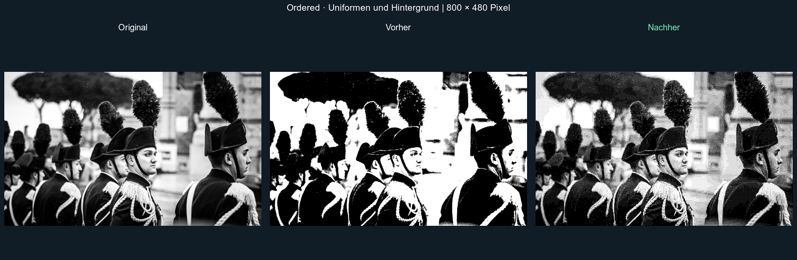
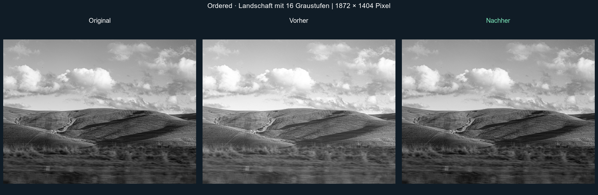
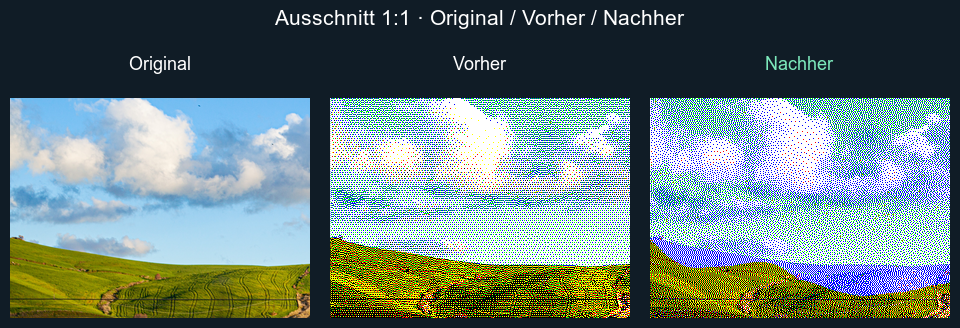
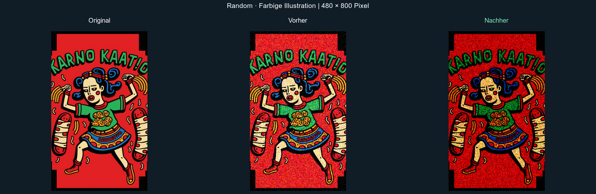
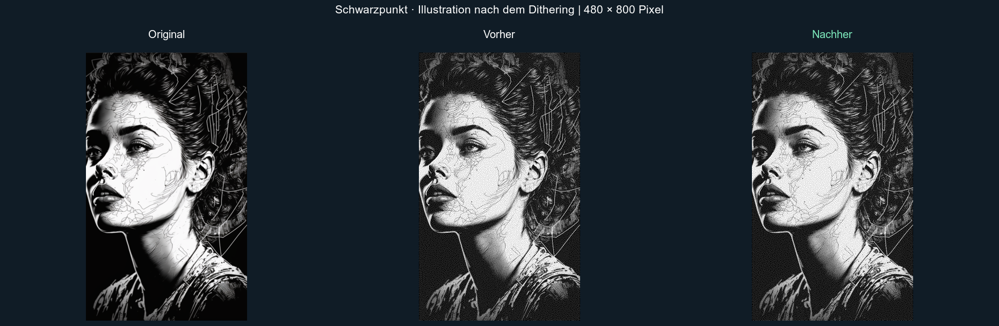
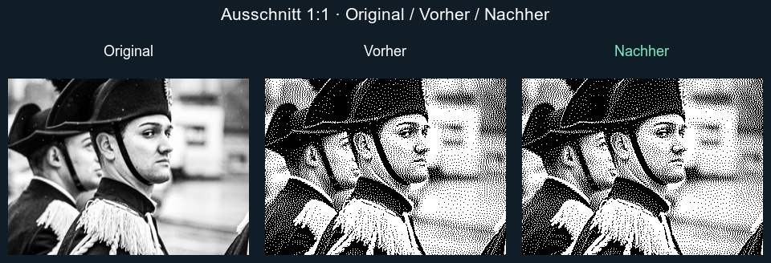

# Algorithm corrections: EPD-resolution comparisons

Each image shows original → before → after. The source is resized/cropped **before** dithering. Before is `03494668` (including #29); after applies the five corrections in this PR. No auto-tuning is applied. These are digital output colors, not a simulation of a physical panel.

| Case | Processing size | Change |
| --- | --- | --- |
| Ordered, soldiers | 800 × 480, black/white | Preserve intermediate tones instead of adding a positive threshold bias. |
| Ordered, landscape | 1872 × 1404, 16 grays | Remove the brightness shift; retain exact palette levels. |
| DitherIt, landscape | 800 × 480, Spectra 6 Original | Process column zero and the horizontal diffusion entry on reverse rows. Invalid pixels: 240 → 0. |
| Random, illustration | 480 × 800, Spectra 6 Original | Emit only requested palette colors. Invalid pixels: 32,370 → 0. This is output validity, not a guarantee of better visual fidelity. |
| Black point, portrait | 480 × 800, black/white | Apply the selected black point to pure black too, before Floyd–Steinberg dithering. Black 24, white 240, fast compression. |
| Jarvis, soldiers | 800 × 480, black/white | Restore total kernel weight from 47/48 to 1; a subtle tonal change, not a dramatic detail improvement. |

## Ordered




## DitherIt

Unscaled 300 × 220 crops starting at the left edge; the first column contained untouched input pixels on alternating rows.



## Random



## Black point

This comparison includes the final dithered output, not just the adjustment stage. The correction matters when a lifted black point is requested.



## Jarvis

Unscaled 300 × 220 crops. In a separate flat-field test with target gray 32, the mean output changes from 28.871 to 30.645 (finite-image boundary loss remains).



## Reproduce

The renderer requires Node, ImageMagick (`magick`) and the corresponding files in `examples/sampleImages/` (ignored by Git). It uses fixed seed `20261110`, RGB matching and the JS engine. Source images use a centered cover crop with Lanczos resizing. Settings, crop coordinates and counts are written to `manifest.json`.

Build the baseline commit in a separate worktree using `npm ci && npm run build`. Then in this branch:

```sh
npm ci
npm test
EPD_BASELINE_BUNDLE=/absolute/path/to/baseline/dist/index.mjs node scripts/render-realistic-comparisons.mjs
```

Open `output/algorithm-comparisons/epd/index.html` for full-resolution PNGs, native-size crops and an original/before/after toggle. `scripts/render-algorithm-comparisons.mjs` also renders diagnostic fields. Set `EPD_COMPARISON_FONT` to a locally installed ImageMagick font name or font file if DejaVu Sans is unavailable.

## RgbQuant build patch

The pinned RgbQuant source contains two reverse-loop bounds errors. `scripts/patch-rgbquant.mjs` runs before the library build, demo build and demo dev server. It verifies both expected snippets before writing and is idempotent. An unexpected upstream source fails the build rather than silently skipping the fix. The published bundles already include the corrected code; consumers do not need a postinstall patch. `patches/rgbquant-serpentine.patch` records the two upstream changes for review.
