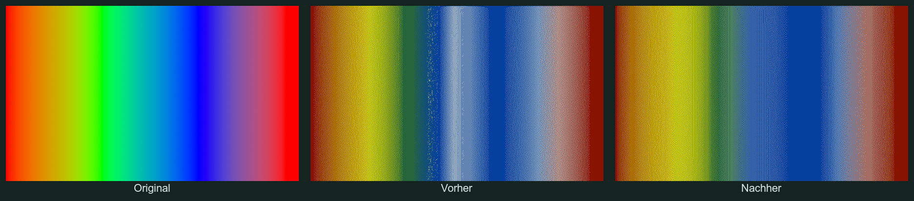
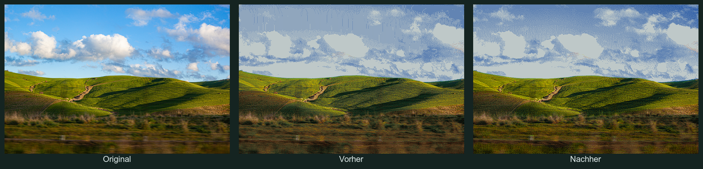

# Error diffusion: before and after

The comparisons show original input, previous output, and output with signed
floating-point diffusion errors. Extreme residuals are scaled as a vector to
avoid carrying out-of-gamut error into distant regions.

Both sides use the same `aitjcize-spectra6` palette, RGB matching,
Floyd–Steinberg diffusion, serpentine scanning, and no image adjustments.
Inputs have a maximum edge length of 800 pixels. These are simulated display
colors, not the device transport codes or photographs of a physical panel.
The contact sheets below are scaled for viewing; the generator also saves
individual PNGs at processing resolution.





The rainbow's total white-pixel share changes from 19.71% to 13.39%; the
landscape's changes from 40.35% to 38.61%. White-pixel share alone is not a
quality metric, and this change does not expand the palette's gamut.

## Reproduce the gallery

Before applying the change, capture a baseline bundle:

```sh
npm run build
mkdir -p output/error-diffusion-comparison/baseline
cp dist/index.mjs output/error-diffusion-comparison/baseline/index.mjs
cp -R dist/assets output/error-diffusion-comparison/baseline/assets
```

After applying the change:

```sh
npm run build
node scripts/compare-error-diffusion.mjs
```

The script requires ImageMagick and sample images in `examples/sampleImages`.
It writes `output/error-diffusion-comparison/index.html` and a JSON manifest
with settings, hashes and palette counts. Each image is rendered both with
neutral settings and with the same automatic recommendation for both versions.
It also checks output palette membership and JS/WASM parity for RGB rendering.

Optional filenames restrict the gallery, for example:

```sh
node scripts/compare-error-diffusion.mjs rainbow.png landscape.jpg
```

`COMPARISON_BASELINE`, `COMPARISON_OUTPUT` and `COMPARISON_SAMPLES` override
the baseline bundle, output directory and input directory respectively. Most
sample images are local assets and are not included in a fresh checkout.
