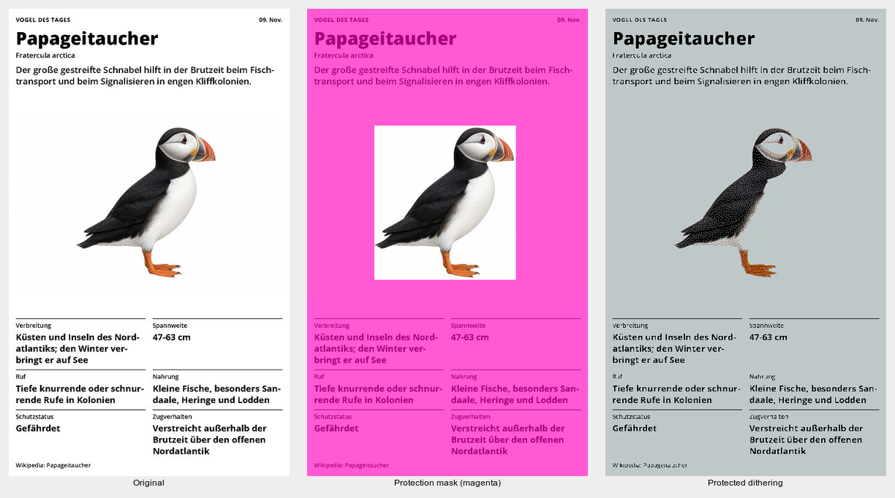

# Automatic text and graphics protection

A cutout illustration and lettering share the same white page. With
`protectTextAndGraphics: true`, the illustration keeps dithering while text
is directly quantized. The middle image highlights protected pixels in magenta.

This comparison uses the portrait Bird of the Day Dev preview fixture,
480×800, Spectra 6 comparison palette, LAB matching, Floyd–Steinberg,
serpentine scanning, JavaScript, and no tone adjustment. The montage is resized
for documentation; processing and assertions use the original resolution.
The gray paper color in the output is the comparison palette's simulated white;
`replaceColors` performs the separate device-color encoding.

## Validation

- `npm test`: full package suite, including 15 text-protection regression tests.
- `npm run typecheck` and `npm run build:examples`.
- `npm run test:text-graphics:layouts`: six flattened photo/text layouts;
  complete text/background protection and no protected photo pixels.
- `npm run test:text-graphics:demos`: local sample collection; palette membership,
  exact quantization of protected pixels and unchanged output for empty masks.
- Portrait/landscape bird fixtures and inverted variants: every pixel in the
  independently selected text bands is protected; non-white illustration pixels
  in the illustration band remain unprotected. Test coordinates are never sent
  to the detector. Lossless synthetic layouts also cover colored/dark backgrounds.

The bird fixtures originate from JPEG browser captures, not lossless server
renderings. See [fixture provenance](../../../tests/fixtures/README.md).
No physical-device validation is claimed.

## Limits

This is an opt-in spatial heuristic, not OCR or semantic object segmentation.
Continuous-tone objects are excluded by a bounding box rather than a traced
silhouette. Text on photos, small/low-contrast text and scanned layouts remain
ambiguous. The tested calendar and country cards still contain protection gaps;
some colored weather icons also remain unprotected. Aggregate mask coverage is
not recognition accuracy.
