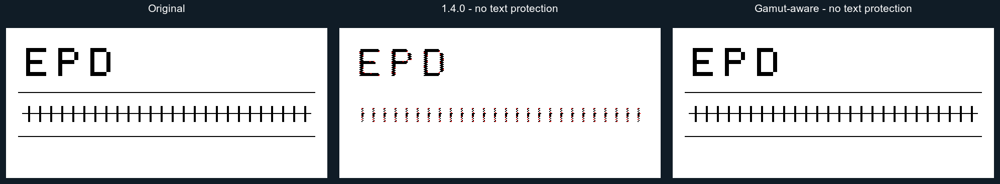

# Gamut-aware native error diffusion

## Problem and change

With calibrated palettes, a hard white/black source can contain colors outside the
palette's convex hull. The signed floating-point implementation in 1.4.0 repeatedly
propagates the unrepresentable component, producing colored speckles and damaged
strokes even when the source has no antialiasing.

The native `errorDiffusion` path now projects each adjusted source RGB value onto
the closest reachable **mixture** in the palette's RGB convex hull, then adds the
accumulated error and selects an ink as before. The final residual remains signed
and fractional. Incoming errors are not projected or clipped back into byte RGB.
The existing bound on large residual vectors remains in place.

This is the algorithm reviewed as **prototype B**. It does not inspect text,
coordinates, edge masks or semantic regions. It changes photographic pixels too.
Existing optional `protectTextAndGraphics` handling takes precedence for pixels
that the caller chooses to protect.

## Scope and limits

- Applies automatically to native `ditheringType: "errorDiffusion"` in JS and RGB
  WASM, including the `auto` engine. Lab/chroma matching still uses JS.
- Supports 1–8 distinct colors, including duplicate, collinear and planar palettes.
  Larger collinear palettes are reduced to their segment endpoints for projection,
  while the original palette is still used for ink selection. This includes
  16-level grayscale.
- Larger non-collinear palettes retain the existing signed-error implementation.
  Other algorithms and DitherIt-backed aliases are unchanged.
- The convex hull uses RGB code values to match the existing diffusion residuals.
  This is not a physical or linear-light model of ink coverage.
- Mapping out-of-gamut colors can alter photo hue, highlight separation and raster
  structure. Successful sharp-edge cases do not imply exact preservation of every
  colored/antialiased graphic or text adjoining photographic content.
- The exact-key projection cache is bounded at 65,536 entries (1.75 MiB of typed
  arrays). WASM additionally streams one Float64 RGB row (24 bytes per column),
  rather than allocating a second image-sized Float64 buffer.

## Reproducible regression image



The source is a synthetic 320×150 binary image generated by
`scripts/render-gamut-comparison.mjs`; no font rasterization, private photos or
external assets are involved. With the calibrated Spectra-6 palette, Sierra-3,
serpentine scanning, Lab matching and text protection disabled:

| Version | Pixels changed from the original device colors |
| --- | ---: |
| 1.4.0 | 1,462 |
| New algorithm | 0 |

The PNG is enlarged 2× with nearest-neighbor interpolation. The accompanying JSON
records the settings and counts. Regenerate after `npm run build` by passing an
installed 1.4.0 ESM entry point:

```sh
node scripts/render-gamut-comparison.mjs /path/to/epdoptimize-1.4.0/dist/index.mjs
```

Requires ImageMagick. `EPD_COMPARISON_FONT` can override the annotation font.

## Validation

- `npm test`: 63 passing tests, including cyan/mixture means, untouched sources,
  sharp black/white strokes with protection disabled, degenerate palettes,
  grayscale ramps, cache collisions and larger-palette fallback behavior.
- JS/WASM byte parity across all 13 existing diffusion kernels, scan directions,
  narrow images and additional degenerate/fallback palettes. Direct WASM tests
  exercise fractional projected rows and error propagation between row calls.
- `npm run typecheck` and `npm run build:examples` pass; the CommonJS package loads.
- Real Chromium canvas smoke check passes for JS, WASM and `auto`, with exact
  output equality and only the expected calibrated black/white values.
- Rebuilding `npm run build:wasm` reproduces both the checked-in binary and the
  embedded module byte-for-byte.
- The existing WASM benchmark reports no JS/WASM output mismatches in its 12
  configurations. Projection adds processing work; these results are not a claim
  that the new version is faster than 1.4.0.

The local A/B review additionally covers 44 EPD Optimize sample images at their
original sizes and at 800×480 or 480×800: 88 comparisons in total. These local
sample files are not part of the repository. The production implementation's
calibrated output was compared pixel-for-pixel against the reviewed prototype B
using the exact same prepared input in each case. No input or image-adjustment
changes were mixed into that comparison.
