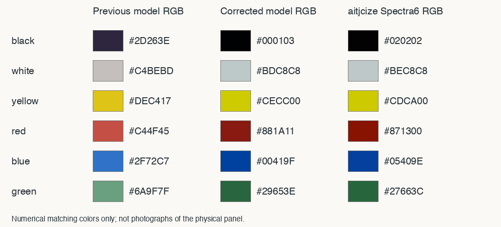
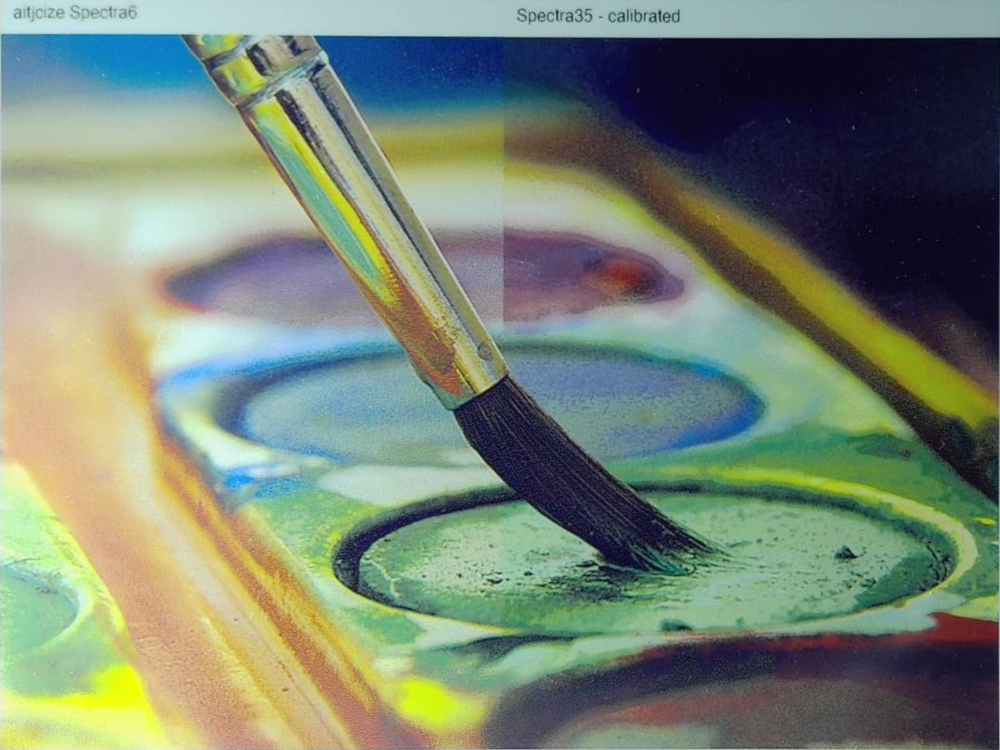

# Spectra35 — experimental tests

> **EXPERIMENTAL · NOT A STANDARD SPECTRA6 OUTPUT FORMAT.**
> This is a camera-derived 35-state palette for one experimental 13.3-inch
> OpenPaper L setup. It needs custom firmware and a matching multi-pass LUT
> adapter. Changing panel drive can permanently damage the panel. Do not upload
> the token image through the normal device API or interpret it as native RGB.

“Spectra35” is the project's experiment name, not a manufacturer-specified
35-color panel mode. The 35 entries identify preparation/waveform recipes;
not all pairs are proven independently distinguishable under every condition.

## Use the palette

In the [demo](https://paperlesspaper.github.io/epdoptimize/), select
**Spectra35 · 35 colors · EXPERIMENTAL**. The Dithered preview uses approximate
matching RGB relative to `aitjcizeSpectra6Palette`; the Recipe tokens preview exports `spectra35-recipe-tokens.png`.
Normal device upload is disabled. Choose OpenPaper L and landscape for the
1600 × 1200 bench planner, then follow the custom-driver workflow below.

```js
import {
  applyImageAdjustments,
  ditherCanvas,
  replaceColors,
  spectra35ExperimentalPalette,
  suggestCanvasDitherOptions,
  suggestCanvasImageAdjustmentOptions,
} from 'epdoptimize';

// Fit/rotate the source to 1600 × 1200 BEFORE processing.
// input, adjusted, preview and tokens are separate canvases.
const palette = spectra35ExperimentalPalette;
const image = suggestCanvasImageAdjustmentOptions(input, palette, { intent: 'natural' });
const dither = suggestCanvasDitherOptions(input, palette, { intent: 'natural' });
const options = {
  ...image.adjustmentOptions,
  ...dither.ditherOptions,
  palette,
  processingEngine: 'js',
  calibrate: true,
  previewMode: 'final',
};
await applyImageAdjustments(input, adjusted, options);
await ditherCanvas(adjusted, preview, options);
replaceColors(preview, tokens, palette);
// preview contains model RGB; tokens contains IDs for the LUT adapter.
// Save tokens losslessly as PNG, without resizing or color conversion.
```

The named lookup APIs also accept `spectra35-experimental`:
`getDefaultPalettes()` returns the appearance colors and `getDeviceColors()`
returns the corresponding tokens. Use the same palette for dithering and
replacement; do not pair this palette with a Spectra6 replacement table.
`quantizationOnly` can be selected instead of automatic dithering for solid
fields. It does not synthesize additional intermediate states.

## Matching RGB versus output

| Recipe index | Matching `color` | Output `deviceColor` | Meaning |
| --- | --- | --- | --- |
| 0 | `#000103` | `#010000` | Dark reference state |
| 1 | `#BDC8C8` | `#010001` | Light reference state |
| 3 | `#881A11` | `#010003` | Red recipe; aitjcize reference red is `#871300` |
| 4 | `#00419F` | `#010004` | Blue recipe; **not** native image code 4 |
| 34 | `#1A69A7` | `#010022` | Last recipe in this palette revision |

The 2026-11-25 correction changes all 35 **matching RGB values**, while retaining
names, order and recipe tokens. Names `C03`–`C35` are stable recipe labels, not
claims of standardized hues. The role names `black` and `white` identify
reference endpoints. Their RGB values now describe the aitjcize-relative model,
not literal camera pixel values or guaranteed physical black/white appearance.

The previous camera-derived model assigned too-bright RGB values to several
physical dark states. For example, the red recipe was described as `#C44F45`
and is now `#881A11`. An over-bright model can cause the ditherer to select too
much dark pigment. Correcting `color` changes recipe selection and mixing
proportions; it does not change drive voltages or the physical recipe itself.
No scene-specific brightness curve is added by this correction. Standard
Spectra6 palettes, including `aitjcizeSpectra6Palette`, are unchanged.

The [exact bench palette export](calibration/spectra35-2026-11-25/palette.json)
has SHA-256
`a672dc35b28eaf399825285241860b4d122d076fb2cb6c7d69eb29c69b453d44`.
Use the new palette consistently for adjustment suggestions, dithering and
replacement; cached previews generated with the previous RGB values must be
regenerated before replacement with the new palette. Existing token images
still select the same recipes.



The token RGB integer is `0x010000 + recipeIndex`, for indices 0–34 inclusive.
A token PNG therefore looks almost black. That is expected: it is an index
carrier, not a display preview. Require opaque pixels and reject any token
outside that range rather than choosing the nearest color. Do not resize,
JPEG-compress, interpolate, apply an ICC transform to, or re-dither token images.
The index is not a directly writable four-bit controller code.

## From tokens to a physical image

The [Panels guide](https://docs.paperlesspaper.de/panels/spectra35) supplies the
versioned recipe table, four complete 2048-byte LUTs and an offline planner:

1. Decode tokens to exact recipe indices.
2. Prepare each pixel using the recipe's native Spectra6 history.
3. Run the four LUT passes in their measured order. Each image mask selects a
   waveform bank; the final color depends on both that bank and the history.
4. Verify both controller rasters, every LUT hash and natural BUSY completion.
   A failed staging operation must not trigger a refresh or a blind replay.

Epdoptimize only computes images. This PR does not flash firmware, upload LUTs,
implement a panel driver, or make ordinary Spectra6 firmware accept 35 colors.
Source0 is an experimental hold code, not electrically verified high impedance.
The downloadable planner does not communicate with hardware.

## Calibration and limitations

> **EXPERIMENTAL RELATIVE CALIBRATION.** This aligns the matching model with
> `aitjcizeSpectra6Palette`; it is not absolute colorimetry, an ICC profile or a
> guarantee that fine dither mixtures reproduce the modeled RGB values.

Two freshly prepared, rearranged charts measured the 35 recipes on both
controller halves. Native preparation and final four-LUT-pass states were
captured with 30 camera samples each; the last ten were used. Printed neutral
swatches tracked temporal camera drift. Native black and white fields fitted
quadratic spatial corrections for the strong position-dependent glare and
illumination. Those baseline corrections were retained for the final states.

The six native color anchors map normalized linear camera RGB into linearized
aitjcize RGB using tetrahedral interpolation, followed by sRGB encoding.
Outside-hull states use the nearest simplex's affine extension with explicit
clipping. The [measurement export](calibration/spectra35-2026-11-25/measurements.json)
records every old/new value, repeated measurement, extrapolation and clipping
flag. In particular:

- The independently rearranged chart's **aggregate six-native-anchor** mean
  ΔE76 is **1.42**. This is a consistency check, not the accuracy of all 35 colors.
- **29 of 35** mean recipe measurements are outside the six-anchor convex hull
  (some only slightly), so their mapping uses extrapolation.
- Maximum per-state repeat deviation reaches **23.94 ΔE76**. The intermediate
  colors are substantially less certain than the aggregate anchor check.
- Fine 1-, 2- and 4-pixel mixtures can differ from the average of solid swatches.
  Position, illumination, pigment history, later passes and drift also matter.

The tests do not establish 35 universally stable colors, 16 neutral grays,
reliable skin-tone reproduction, panel lifetime or absolute Source/VCOM voltages.

## Panel comparison with automatic processing

The brush/paint sample was fitted to 1600 × 1200 with English labels. Its left
half uses **`aitjcizeSpectra6Palette`**, and its right half uses the corrected
Spectra35 palette. Both received the same ordinary automatic natural adjustment
and dithering settings shown above, without an extra tone curve, gamut adapter
or bit-depth reduction. Earlier comparisons used the legacy `spectra6Palette`
on the left and must not be treated as the same reference.



This photograph has perspective correction only, no added color correction.
The right side shows finer brush/paint detail than the earlier uncorrected
rendering, but a color/brightness boundary remains visible in the purple bowl.
This is a qualitative observation: the halves contain different scene content
and the lighting varies strongly across the panel.

The [panel verification](calibration/spectra35-2026-11-25/panel-verification.json)
records all five completed passes, unchanged camera controls and mean absolute
left-half RGB drift of **0.80/255** after printed-card drift alignment. Image RAM,
LUT hashes, both controller identities and natural BUSY completion were checked
by the bench runner. A first attempt stopped on a rejected final image upload
before refresh; the successful comparison was rebuilt from a fresh native
preparation with slower USB packet pacing.

The successful build took **402.3 seconds**, including staging, cooldowns and an
intermediate camera capture. This remains an experimental multi-pass photo mode,
not a 120-second build. Source0 preservation is only an observed result for this
run, not proof of electrical high impedance or long-term stability.
